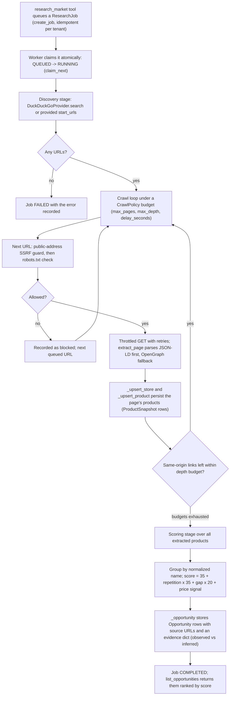

# Architecture

Ares is an internal operations agent for an e-commerce catalog: a FastAPI backend runs an LLM agent that reads from the store, drafts changes and pauses for human approval before any write. A Next.js console provides login, run monitoring and admin views over the same API. The stack persists everything in PostgreSQL or SQLite through SQLAlchemy.

## Module map

| Module | Responsibility |
| --- | --- |
| backend/app/main.py | FastAPI application factory that wires middleware, routers, error handlers and the /metrics endpoint behind an optional global API key gate. |
| backend/app/agent/engine.py | Bounded agent loop that persists every step to the run row and pauses for human approval before any write tool executes. |
| backend/app/agent/runner.py | Worker pool that starts or resumes runs outside the request cycle so each run gets its own database session. |
| backend/app/agent/grounding.py | Tool-call state machine plus a policy that replaces fabricated operational facts with an honest safe-failure message when every tool call failed. |
| backend/app/tools/registry.py | Declarative tool registry providing pydantic-validated inputs, READ/WRITE access levels and the single execution path for all tools. |
| backend/app/tools/content.py | Content tools: deterministic product-content scoring plus LLM-drafted descriptions and titles that return proposals only. |
| backend/app/llm/base.py | Provider-agnostic LLM types (Message, ToolCall, LLMProvider) so the engine never imports a concrete model backend. |
| backend/app/llm/factory.py | Builds the configured provider (openai_compatible, ollama or test) with a process-wide override hook used by tests. |
| backend/app/intelligence/crawler.py | Robots-aware, SSRF-guarded HTTP crawler that fetches public pages and extracts products, links and metadata. |
| backend/app/jobs/queue.py | Durable database-backed job queue with atomic cross-process claiming, per-tenant idempotency keys and bounded retries. |
| backend/app/api/approvals.py | Approval endpoints that list pending decisions and hand approved or rejected runs back to a worker without mutating anything themselves. |
| backend/app/api/auth.py | Identity endpoints (register, login, logout, me, audit) with session tokens, shared API-key machine users and role-based access control. |
| backend/app/observability | Metrics counters, request instrumentation middleware and tracing helpers that expose Prometheus-format /metrics. |
| backend/app/evals/runner.py | Planned: executes the eval task suite against a provider and scores each task (see backend/evals/README.md). |
| backend/mcp_server.py | MCP stdio transport exposing the same registry tools to external clients, with update_product as a direct write for human-driven sessions. |
| src/app | Next.js console with login page, admin dashboard and auth context that talks to the FastAPI backend. |

## The life of a run

```mermaid
stateDiagram-v2
    [*] --> RUNNING : run created as RUNNING, worker calls start()
    RUNNING --> WAITING_FOR_APPROVAL : WRITE tool queued; _request_approval() creates an ApprovalRequest
    WAITING_FOR_APPROVAL --> RUNNING : human decides; resume() re-enters the loop
    WAITING_FOR_APPROVAL --> WAITING_FOR_APPROVAL : resume finds approval still PENDING, stays parked
    RUNNING --> COMPLETED : final answer passes the grounding gate (_complete)
    RUNNING --> COMPLETED : limit hit, _wrap_up() summary accepted
    RUNNING --> FAILED : timeout, LLM error or unexpected exception (_fail)
    RUNNING --> FAILED : retries exhausted on invalid arguments or failed tools (_fail)
    RUNNING --> FAILED : ungrounded answer blocked after retries; limit-hit summary rejected by the grounding gate (_fail)
    COMPLETED --> [*]
    FAILED --> [*]
```

1. `backend/app/db/models.py` defines RunStatus with RUNNING, WAITING_FOR_APPROVAL, COMPLETED and FAILED; terminal() is COMPLETED plus FAILED.
2. `backend/app/agent/runner.py` creates runs as RUNNING and hands them to a worker pool; submit_resume re-enters after an approval decision.
3. `backend/app/agent/engine.py` owns every status change: _loop pauses when the drain returns, resume() restarts it, and _complete/_fail set terminal states.
4. `backend/app/api/approvals.py` records the human decision on the ApprovalRequest row and calls runner.submit_resume; it never mutates run state itself.

## The agent loop

```mermaid
sequenceDiagram
    participant E as AgentEngine
    participant L as LLMProvider
    participant R as ToolRegistry
    participant D as ApprovalRequest row
    Note over E: _loop iteration: deadline check, drain pending calls, limits checks
    E->>L: chat(messages, registry.llm_specs())
    L-->>E: response with tool_calls (or a final answer)
    alt no tool_calls
        Note over E: grounding gate; _complete() or a correction message back into the loop
    else tool calls queued as pending_tool_calls
        loop each call in _drain_pending
            alt READ tool
                E->>R: execute(name, arguments, ctx) via _execute
                R-->>E: result recorded by _finish_call
            else WRITE tool (requires_approval)
                E->>D: _request_approval(run, call) creates the row
                Note over E: status becomes WAITING_FOR_APPROVAL; loop returns
            end
        end
    end
```

1. `backend/app/agent/engine.py` _loop is one iteration: deadline check, drain pending calls, limits checks, then llm.chat with registry.llm_specs().
2. `backend/app/llm/base.py` LLMProvider.chat returns a response whose tool_calls may be empty (final answer) or not.
3. `backend/app/tools/registry.py` execute() is the single execution path for every tool; llm_specs() feeds its schemas to the model.
4. `backend/app/agent/engine.py` _drain_pending runs READ tools at once through _execute and records each outcome with _finish_call.
5. `backend/app/db/models.py` ApprovalRequest rows carry PENDING, APPROVED or REJECTED status plus the stored result of an approved call.

## Market intelligence



1. `backend/app/tools/intelligence.py` research_market calls create_job and returns a job id; list_opportunities reads the results back.
2. `backend/app/services/intelligence_jobs.py` execute_job claims the row, drives run_investigation, and records failures with retry backoff.
3. `backend/app/intelligence/discovery.py` DuckDuckGoProvider.search returns public result URLs for a query; it only discovers, never verifies.
4. `backend/app/intelligence/crawler.py` ResponsibleCrawler enforces the SSRF guard, robots.txt, per-host throttling and page/depth budgets; extract_page runs on every fetched body.
5. `backend/app/services/intelligence.py` run_investigation upserts stores and products, then scores clusters into Opportunity rows with source URLs and an evidence dict that separates observed facts from inferences.

## Jobs and workers

1. `backend/app/jobs/queue.py` is a durable database-backed queue: enqueue() dedupes by idempotency signature per tenant, claim_next() atomically moves QUEUED to RUNNING via a guarded UPDATE, and record_failure() requeues with backoff up to 3 attempts before FAILED.
2. `backend/app/jobs/transport.py` is only the delivery mechanism behind QueueBackend: RedisQueueBackend gives at-least-once delivery with stale reclaim in production; InlineQueueBackend runs handlers synchronously for tests and embedded local dev.
3. `backend/app/services/intelligence_jobs.py` registers the research handler, keeps execute_job idempotent against duplicate delivery, and requeues jobs orphaned by a crash via recover_stale_jobs at startup.
4. Agent runs are not in this queue: `backend/app/agent/runner.py` hands them to an in-process worker pool instead, with the same durable-row principle (the AgentRun row survives pauses).

## Auth and roles

Roles form an ordered hierarchy (ROLE_LEVEL) enforced server-side on every request via require_role; a role can do anything its juniors can. Public sign-up creates viewers only; only an admin caller may create accounts with another role. Sessions are random tokens stored as SHA-256 hashes with a 12 hour TTL, and passwords use scrypt.

| Role | Level | What it may do |
|---|---|---|
| viewer | 0 | Sign up publicly, log in, and use authenticated endpoints that no higher role gates. |
| analyst | 1 | Everything a viewer can do; no endpoint currently requires exactly this level (it sits between viewer and manager for future gating). |
| manager | 2 | Everything below plus read the audit log (/auth/audit is gated by require_role(manager)). |
| admin | 3 | Everything below plus manage users in their own organization: list, change roles or deactivate with last-active-admin protection, and view organizations; only admins can create non-viewer accounts. |

## More

- [Design decisions](DESIGN.md)
- [Security model](SECURITY.md)
- [Evals](EVALS.md)
